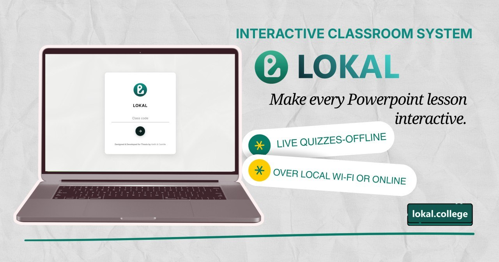
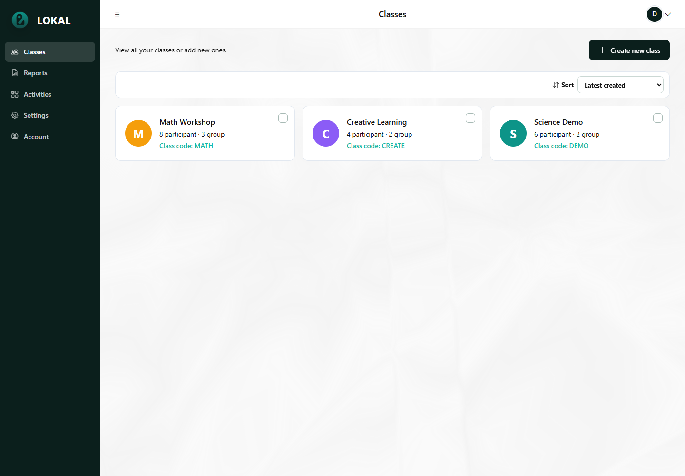
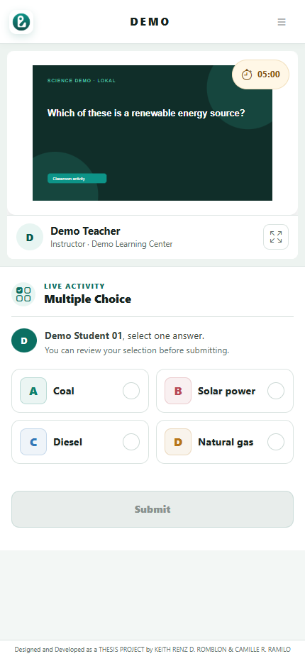
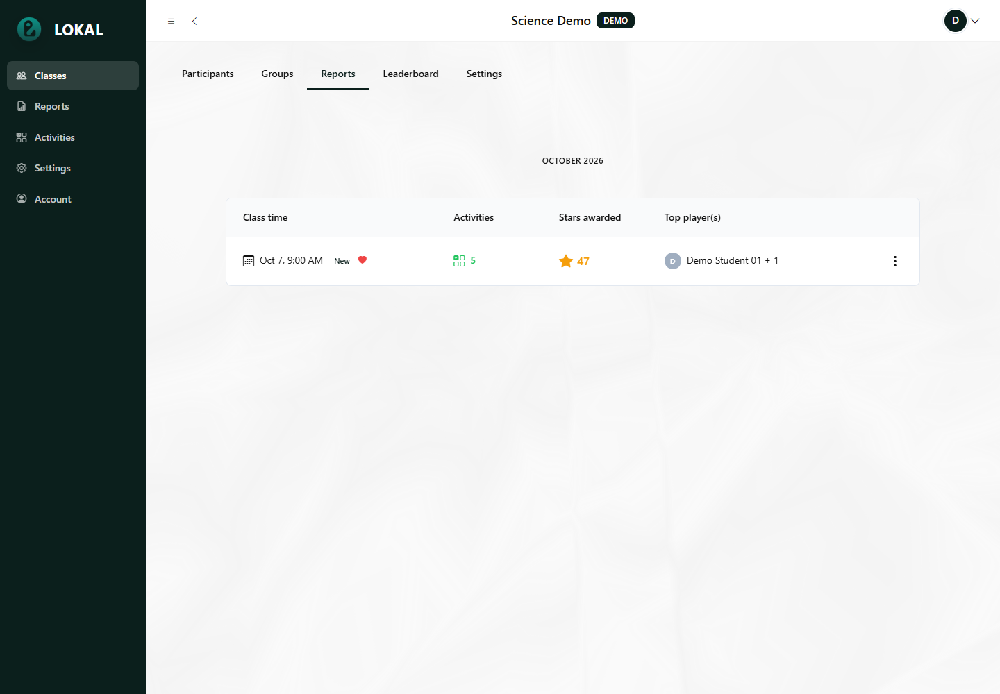

# LOKAL

### Your PowerPoint. A more interactive classroom.

An offline-first classroom response, presentation, and engagement system.

[Download LOKAL](https://download.lokal.college/) · [User Guide](https://help.lokal.college/) · [Online Teacher Dashboard](https://app.lokal.college/) · [GitHub Releases](https://github.com/ke1thdev/LOKAL-Downloads/releases)

## About LOKAL

LOKAL helps teachers turn PowerPoint lessons into interactive classroom experiences. Teachers present their slides, launch activities, review student responses, and recognize participation without switching away from their teaching workflow. Students join through a web browser using a class code, link, or QR code.

The local classroom installation can operate over a reachable Wi-Fi or wired network without an internet connection. Optional online services support internet-based participation and local-to-cloud classroom backup.

This repository provides public downloads and documentation. It is not the application's development source repository. To install LOKAL, download the installer from the download website or GitHub Releases—not GitHub's **Download ZIP** option.

## Classroom activities

Prepare activities in PowerPoint and collect responses from students' browsers.

| Activity | What students can do |
| --- | --- |
| Multiple Choice | Select an answer from the available choices. |
| Word Cloud | Submit words or short phrases for a shared response display. |
| Short Answer | Respond to a prompt in their own words. |
| Image Upload | Submit an image for teacher review and discussion. |
| Fill in the Blanks | Complete the missing parts of a question or statement. |

Teachers can configure supported activity options, control response collection, reveal submissions, and review answers. Automatic scoring is available for supported quiz configurations; other responses require teacher judgment.

## Presentation and classroom tools

- **Annotations and whiteboards:** Explain ideas using drawing, highlighting, text, shapes, and additional writing space.
- **Timer and stopwatch:** Manage classroom tasks and timed activities.
- **Name Picker:** Select participants for discussion or classroom tasks.
- **Quick Poll:** Gather immediate feedback during a lesson.
- **Stars and leaderboards:** Recognize participation and display individual or group standings.
- **Class management:** Organize participants, groups, class sessions, and activity records.

Stars represent rewards within the teacher's classroom workflow. They should not be treated as a complete measure of learning or achievement.

## Teacher dashboard and reports

The teacher dashboard brings classes, activities, accounts, and reports together in one place. Teachers can review saved submissions, activity results, and reward records, then export supported reports to Excel.

Reports support classroom review and follow-up. Automated scores and summaries do not replace a teacher's assessment of students' work.

Explore the teacher and student interfaces

### Teacher classes

### Student participation

### Class reports

Screenshots use demonstration records. Interface appearance may vary between installations.

## Offline and online use

| Setup | How it works |
| --- | --- |
| Local classroom | The teacher's computer runs LOKAL. Students connect to its reachable classroom address over the same Wi-Fi or wired network. Internet access is not required for the local lesson. |
| Online classroom | Students use the configured public classroom address. Internet access is required, and the desktop PowerPoint add-in still runs on the teacher's Windows computer. |
| Optional cloud backup | An enrolled local installation can send queued classroom changes to the connected online account when connectivity is available. |

**Offline-first does not mean network-free.** Students still need a working network connection to the teacher's local server. An address beginning with `127.0.0.1` refers to the device opening it; students on other devices must use the teacher's reachable classroom address instead.

Local and online accounts are separate until connected through the supported account workflow. Cloud backup is not a general-purpose, two-way merge between computers. Do not assume that signing in online automatically transfers every local record.

## Requirements

### Teacher's computer

- A 64-bit Windows computer with a compatible desktop Microsoft PowerPoint installation.
- Permission to install the LOKAL desktop components and any required prerequisites.
- A reachable classroom network for local participation, or internet access for online services.
- Sufficient storage for classroom records, uploaded media, and exported reports.

Microsoft PowerPoint is not included. The desktop add-in does not run inside PowerPoint for the web or PowerPoint for macOS.

### Student devices

- A supported web browser on a phone, tablet, or computer.
- Network access to the classroom address provided by the teacher.

Students do not need to install the Windows PowerPoint add-in.

## Getting started

1. Download the installer from the [LOKAL download website](https://download.lokal.college/) or [GitHub Releases](https://github.com/ke1thdev/LOKAL-Downloads/releases).
2. Close PowerPoint before installation. Run the installer, review the license agreement, and approve the Windows permission prompt when requested.
3. Open desktop PowerPoint and locate the LOKAL ribbon.
4. Sign in or create an account, prepare a class, and add an activity to a lesson.
5. Display the joining details and have students open the classroom address in their browsers.
6. Start the activity, collect responses, and review the results.

For illustrated instructions and troubleshooting, visit the [LOKAL User Guide](https://help.lokal.college/). Test the complete teacher-and-student workflow on your intended devices before using it for a classroom assessment.

## Optional local AI summaries

LOKAL includes an experimental report-summary feature for the local classroom installation. It runs in the browser viewing the report, using Transformers.js and ONNX Runtime Web with a separately imported, verified `.lokalmodel` pack. AI model weights are not bundled with the installer, and GGUF files are not compatible with this browser engine.

CPU processing uses WebAssembly. GPU processing requires compatible WebGPU support; having a dedicated graphics card alone does not guarantee compatibility. Model storage is specific to the browser and site address, and clearing browser data can remove the imported model.

Summary generation does not send report content to a cloud AI service. This feature is not available on the hosted teacher dashboard, and classroom activities do not require it. Always compare generated text with the saved report figures; summaries may be incomplete or inaccurate.

## Privacy and responsible use

Classroom records can include participant identities, answers, uploaded images, response observations, and reward history. Use LOKAL on authorized computers and networks, and follow your institution's consent and data-handling requirements.

- Restrict access to the teacher's computer and classroom reports.
- Back up important records before updates, resets, or maintenance.
- Keep named exports and submitted images private.
- Use fictional or anonymized records in demonstrations and public screenshots.
- Do not assume that a local-network connection is encrypted or that anonymous display removes identity information from saved records.

Read the [Privacy Policy](https://lokal.college/privacy) and [Terms of Use](https://lokal.college/terms) for additional information.

## Help and feedback

- **Instructions:** [LOKAL User Guide](https://help.lokal.college/)
- **Downloads, release notes, and available verification details:** [GitHub Releases](https://github.com/ke1thdev/LOKAL-Downloads/releases)
- **Non-sensitive bug reports:** [GitHub Issues](https://github.com/ke1thdev/LOKAL-Downloads/issues)
- **Account, support, and privacy inquiries:** [contactus@lokal.college](mailto:contactus@lokal.college)

When reporting a problem, describe the steps, expected result, actual result, and relevant device or browser information. Include a fictional example where possible. Do not post real classroom reports, databases, passwords, access tokens, recovery codes, or private keys in public issues.

## Project authors

Developed as an academic thesis project by **Keith Renz D. Romblon** and **Camille R. Ramilo**.

LOKAL is independent and is not affiliated with or endorsed by Microsoft or ClassPoint. Product names belong to their respective owners.

## License

Use and distribution are governed by the [LOKAL software license agreement](installer/bootstrapper/EULA.txt), also presented during installation. Public availability of the installer does not grant an open-source license.
